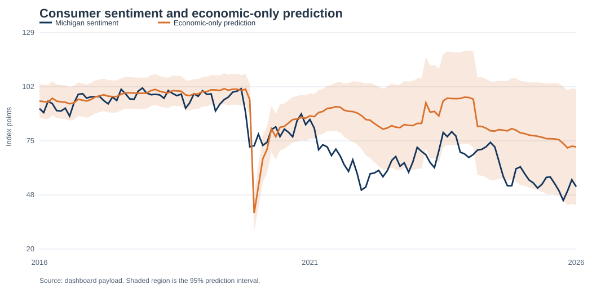
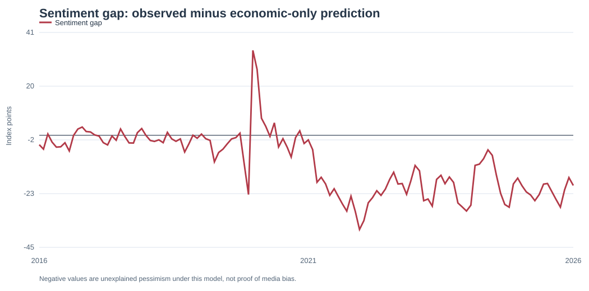
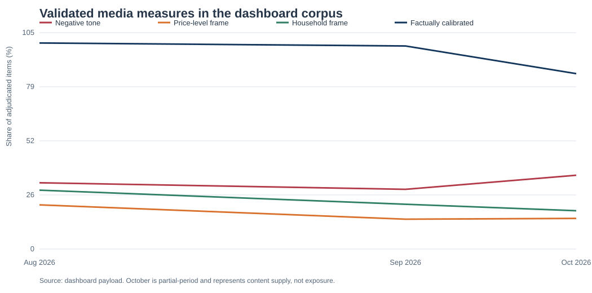

# AI Economic Perceptions and Consumer Sentiment

A measurement and forecasting framework ahead of the 2026 midterm elections

Alan Wang

FRE-GY 7871: NLP & the Investment Process

Analysis cutoff: October 14, 2026

## Executive summary

This project develops a reproducible framework for separating economic conditions, economic narratives, and consumer sentiment. It asks whether an economic-only model leaves a persistent Michigan consumer-sentiment gap and whether carefully measured media variables improve understanding of that gap. The project treats a negative residual as unexplained pessimism under a specified model, not as proof that consumers are irrational or that coverage is biased.[7][8]

### Findings

The chronology-respecting economic-only rolling forecast has an out-of-sample MAE of 12.579 index points and RMSE of 16.458 across 126 forecasts. Its residuals are strongly autocorrelated, so it is a baseline rather than a complete explanation. The expanded-controls forecast reduces MAE to 4.467 and RMSE to 6.236 across 142 out-of-sample forecasts, showing that headline macro indicators do not capture the full household-relevant information set.[13]

Two source-blinded human coders independently labeled 312 retained items. Tone agreement was 59.3% with Cohen kappa of 0.437, and disagreements were adjudicated before the monthly media measure was constructed.[10][17] In the 2014-2021 archive, a 10-percentage-point increase in prior-month negative tone is associated with an 8.09-point lower headline sentiment reading after controls, but this is an observational association rather than a causal media effect. Adding historical media tone does not improve the primary common-sample MAE (6.04 versus 5.93 for economic-only), even though RMSE declines modestly (9.84 versus 10.63); therefore, narratives are monitored as risk signals rather than inserted mechanically into a production forecast.[14][15][11]
### Practical implication

For financial forecasting and risk management, sentiment should be monitored as a potentially informative but noisy state variable. A model-risk process should retain real-time vintages, track the sentiment gap and media-measure quality, and escalate large unexplained gaps for human review rather than labeling them “bias.”

## Research question and analytical design

The project evaluates three competing explanations for sentiment that appears weak relative to selected macro indicators: unmeasured household pressure, differences in information and framing, and measurement or timing limitations. The design therefore separates prediction from explanation and association from causal impact.[7][11]

| Question | Operational response | What the evidence can support |
| --- | --- | --- |
| Economic baseline | Monthly, availability-aware rolling forecasts using U-3, PCE inflation, and quarterly real GDP growth. | Out-of-sample predictive performance and a sentiment gap. |
| Household pressures | Supplementary controls include U-6, real disposable income, cumulative PCE-price change, debt service, housing affordability, and policy uncertainty. | Whether broader aggregates improve forecasts; not household-level causal effects. |
| Narrative measurement | Source-blinded coding of tone, salience, framing, factual calibration, and political attribution. | Descriptive content-supply measures and selected cross-source contrasts. |
| Media and sentiment | Chronological media models and HAC association estimates with a future-media placebo. | Associations and forecasting comparisons, not media-exposure effects. |
| Causal evidence | Pre-specified randomized truthful-framing experiment proposed for future work. | A feasible next step, subject to approval and fielding. |

Source: course brief and project causal-design protocol.[7][11]

## Hypotheses and planned tests

The household-pressure hypothesis states that the narrow macro baseline omits conditions that matter to households, including broader labor underutilization, real income, cumulative price levels, debt-service burdens, housing affordability, and policy uncertainty. It is supported only if a broader, availability-aware specification improves out-of-sample performance without relying on outcome leakage.

The information-and-framing hypothesis states that validated content-supply measures may be associated with sentiment or add incremental predictive value. The test is deliberately demanding: the coding must be auditable, the comparison must be against declared benchmarks, and media measures must improve chronological holdouts or remain stable in the historical association model. It does not presume that negative coverage is biased, or that content supply equals respondent exposure.

The timing-and-incomplete-model hypothesis states that the apparent gap can reflect release timing, data revisions, survey-method changes, partial periods, or omitted predictors. It is assessed through availability-aware vintages, residual autocorrelation, prediction intervals, model sensitivity, and explicit partial-period and methodological-transition flags.[2][4][11]

## Direct answers to the required research questions

### 1. How can bias in coverage or social media be measured?

Bias cannot be inferred from negativity alone. This project measures tone, selection and salience, framing, factual calibration, and political attribution, then assesses each against a declared content benchmark such as matched publication-day/topic cells or comparable economic releases. The available national-versus-local negative-tone contrast is +21.3 percentage points across 18 matched cells, but its interval spans -1.24 to +43.83 points. That result is too imprecise to establish systematic source bias.[9][16][17]

### 2. What impact is bias having on Michigan sentiment before the midterms?

The current evidence cannot determine a causal impact. Prior-month negative tone is associated with lower sentiment in the historical model, but the design lacks respondent-level exposure, exogenous variation, and a representative link from the content sample to Michigan respondents. Reverse causality, audience demand, and common economic or political shocks remain plausible. The appropriate next step is the documented randomized truthful-framing experiment or a credible exposure-based quasi-experiment, not a causal claim about the national index.[11][15]

### 3. How much of the discrepancy do unemployment, inflation, and GDP growth explain?

The economic-only model provides a useful but incomplete answer rather than a percentage decomposition. Its 126 chronological forecasts have MAE 12.579 and RMSE 16.458, and the partial October 2026 dashboard observation shows sentiment of 46.3 against a prediction of 75.3, a -29.0-point gap. Adding broader household-relevant controls improves forecasting performance, but the different specifications and samples do not identify a defensible share of the gap attributable to any one indicator.[13][17]

### 4. Which perceptual mechanisms can the data measure?

The data measure content-level negativity, issue salience, framing of price levels versus inflation rates, household versus national framing, factual calibration, and political attribution. They do not measure confirmation bias, availability bias, or price anchoring as respondent-level cognitive mechanisms because there are no exposure, recall, belief, or experimental outcomes. Cumulative prices are a household-pressure control, not evidence that respondents are cognitively anchored to past prices.[9][11][16]

### 5. Does media analysis improve predictions beyond economic indicators?

Not in the primary common historical holdout. Adding one-month negative media tone raises MAE from 5.929 to 6.040, while reducing RMSE from 10.629 to 9.836. The mixed result does not support a robust incremental-forecasting claim, particularly with only 41 common out-of-sample observations; media remains a monitored diagnostic rather than a production predictor.[14]

### 6. What evidence would contradict a media-bias explanation?

The project already contains several contradictory or limiting findings: weak incremental MAE performance, an imprecise matched-source contrast, a lack of observed exposure, and material improvement when broader household controls are added. A stable null result in future, pre-registered exposure-based tests, or a credible result showing that household pressures fully absorb the association, would further contradict a media-bias explanation. A null future-media placebo does not establish causality; it is only one timing diagnostic.[11][13][15][16]

### Pre-specified interpretation rules

Negative coverage is not defined as biased merely because it is negative; a bias claim requires a declared benchmark, such as comparable releases or matched topic-day content. Text data measure content supply and framing, not what Michigan respondents encountered, recalled, or believed. Likewise, a null or weak media forecast improvement counts against a strong incremental-prediction claim, but does not prove that media never matters.[7][11]
## Economic and survey baseline

The analysis begins in 2010 at monthly frequency. The supplied course workbook provides the Michigan headline index, U-3 unemployment, PCE inflation, and quarterly real GDP growth. The reproducible package supplements it with documented public macro series and an ALFRED-vintage archive.[3][6][5][2] Predictions use conservative availability rules and do not interpolate quarterly GDP into artificial monthly observations.

| Series | Role and timing treatment | Key interpretation safeguard |
| --- | --- | --- |
| Michigan consumer sentiment | Outcome; headline index plus available Current Conditions and Expectations subindices. | The survey covers financial, business, and buying views; it is not a direct vote on U-3, PCE, or GDP. |
| U-3 unemployment | Core economic predictor; seasonally adjusted official rate. | Labor-force definition differs from broader household stress and underemployment. |
| PCE inflation | Year-over-year price-index change. | Disinflation does not reverse the level effect of previously elevated prices. |
| Real GDP growth | Quarterly quarter-over-quarter annualized growth; held at its actual release cadence. | Aggregate output growth can diverge from household experience. |
| Supplementary controls | U-6, real income, cumulative prices, debt service, housing affordability, policy uncertainty. | Controls improve description; they do not solve causal identification. |

Sources: Michigan, BLS, BEA, ALFRED, and EPU documentation; project data contract.[3][6][5][2][1][8]

| Latest stored month | Observed sentiment | Economic-only prediction | Sentiment gap | 95% prediction interval |
| --- | --- | --- | --- | --- |
| October 2026 (partial period) | 46.3 | 75.3 | -29.0 | [51.9, 98.7] |

Table 2. Latest stored baseline comparison. October is explicitly treated as a partial-period observation. Source: project output economic_only_oos.csv.[13][17]

The latest stored observation is partial-period October 2026 and should not be treated as a completed month. The dashboard visibly distinguishes data quality and availability from inferred conditions.

Figure 1. Dashboard reproduction of the sentiment and economic-only prediction chart. The prediction interval and persistent deviations make clear why the gap is treated as a model diagnostic rather than a causal label.[17]

Figure 2. Dashboard reproduction of observed sentiment minus the economic-only prediction. Negative values indicate unexplained pessimism under the specified economic model.[17]

## Balanced media corpus and measurement framework

The corpus is a documented content-supply sample, not a media-exposure panel. It combines economic news cards/headlines from 16 national and local publishers with a public Mastodon supplement. The collection records query, timestamp, source, retained text, deduplication, and automation flags. It does not scrape paywalled article bodies, comments, advertisements, or profiles.[9]

| Dimension | Operationalization in the project | Boundary on interpretation |
| --- | --- | --- |
| Tone | Negative, neutral, positive, mixed, or unclear economic language; separate factual description from emotional wording. | Negative tone is not equivalent to bias. |
| Salience and selection | Mentions of layoffs, hiring, prices, disinflation, growth, and recession risk. | Supply does not equal audience attention. |
| Framing | Price levels versus inflation rates; household experience versus national aggregates; current conditions versus forecasts. | Framing can be described without inferring a reader cognitive bias. |
| Factual calibration | Numerical claims assessed against information available at publication. | Incomplete or unverifiable items are retained as such. |
| Political attribution | Credit or blame assigned to institutions or actors. | Criticism is not automatically bias. |

A matched source-comparative benchmark pairs items within publication-day and pre-specified topic cells. Across 18 local-national matched cells, national items had a 21.3 percentage-point higher negative-tone share, but the 95% normal-approximation interval spans -1.24 to 43.83 points. The evidence is too imprecise to support a broad comparative claim.[16][17]

## AI-assisted measurement validation

The project uses machine labels only as triage and benchmarked classifier outputs, not as ground truth or a second “human” rater. Two independent human annotators received randomized, source-blinded packets; model labels are excluded from human-agreement statistics by design. The completed all-field workflow covers 312 finalized items.[10][17]

| Validation metric | Result | Interpretation |
| --- | --- | --- |
| Paired independent human tone labels | 312 | Exceeds the course minimum of 300. |
| Raw tone agreement | 59.3% | Annotators often differ on nuanced economic language. |
| Cohen kappa | 0.437 | Moderate agreement; supports use with adjudication and disclosed uncertainty. |
| Adjudication | Completed before aggregation | Original votes and decision rationale are preserved. |
| Invariance checks | Actor-name/source masking protocol included | A no-change dictionary result is not a validation claim for an LLM. |

Source: project validation protocol and dashboard payload.[10][17]

| Coded month | Items | Negative tone | Positive tone | Mixed tone | Sources |
| --- | --- | --- | --- | --- | --- |
| Aug 2026 | 28 | 32.1% | 28.6% | 14.3% | 10 |
| Sep 2026 | 69 | 29.0% | 17.4% | 15.9% | 10 |
| Oct 2026 | 215 | 35.8% | 14.9% | 7.4% | 17 |

Table 4. Adjudicated 2026 media-tone mix. Availability reflects final-label build timing, not publication-date exposure. Source: project media_monthly.csv.[16]

The measurement process preserves item IDs, exact retained text, source metadata, evidence spans, prompt/model records, adjudication records, and uncertainty. This makes future audit and recalibration possible while keeping the substantive claims limited to the measured construct.

Figure 3. Dashboard reproduction of the finalized, source-blinded media aggregate. The chart describes the retained content sample; it does not measure audience exposure or persuasion. October is partial-period.[16][17]

## Forecasting results and model comparison

The core forecast comparison uses chronological holdouts. Reported metrics are out-of-sample and reflect the exact information-contract implemented in the pipeline. Performance should be read alongside residual diagnostics, because a low error can still conceal serial dependence or timing leakage.[13][12]

| Model | Out-of-sample n | MAE | RMSE | 95% interval coverage | Residual lag-1 autocorrelation |
| --- | --- | --- | --- | --- | --- |
| Economic-only macro baseline | 126 | 12.579 | 16.458 | 73.8% | 0.830 |
| Economic + lagged sentiment sensitivity | 141 | 3.451 | 4.585 | 90.1% | 0.166 |
| Household-stress proxy extension | 142 | 8.178 | 12.062 | 71.8% | 0.623 |
| Expanded macro controls | 142 | 4.467 | 6.236 | 83.1% | 0.586 |

Source: reproducible run summary.[13]

### Supplementary extension: household-stress proxies

This supplementary extension tests whether two deliberately narrow proxies for undermeasured household pressure improve the economic-only benchmark. It adds the 12-month change in U-3 unemployment and a negative-GDP recession signal. It does not measure household income, debt, housing affordability, cumulative prices, or lived experience directly.

The household-stress extension reduces MAE to 8.178 across 142 forecasts. This result motivates the broader public-control specification, but it is not a causal decomposition of the sentiment gap and should not be read as a direct estimate of household distress.[12][13]

### Supplementary robustness checks: timing and persistence

The notebook's month-end ALFRED-vintage comparison reproduces the economic-only score in this implementation: 126 out-of-sample forecasts, MAE 12.579, RMSE 16.458, and 73.8% interval coverage. This result is a timing robustness check rather than evidence that revisions never matter. The vintage panel tracks information available by month-end, but its date-level contract does not establish intraday release ordering.[2][12][13]

The lagged-sentiment sensitivity model produces MAE 3.451, RMSE 4.585, and 90.1% interval coverage across 141 forecasts. Because it uses the prior value of the outcome, it demonstrates persistence and helps diagnose the baseline's residual autocorrelation; it does not explain why sentiment moved or provide a causal model.[12][13]

The expanded public-control model is the stronger descriptive extension, with MAE 4.467 and RMSE 6.236. Its current-vintage refresh is valuable for prospective monitoring, while historical causal or real-time claims still require archived point-in-time vintages. Together, these supplementary analyses explain why the report treats the narrow baseline as a diagnostic benchmark rather than a complete account of consumer sentiment.[2][12][13]

The notebook also provides the classifier, masking, matched-source, and subgroup contracts summarized later in this report. Those outputs remain measurement and monitoring diagnostics: the dictionary baseline has accuracy 0.580 and macro-F1 0.483 on the 312 adjudicated labels, while actor and outlet masking produces no changes in the dictionary labels across 315 items. Neither result measures audience exposure or validates a causal media mechanism.[10][17]

### Historical media-model comparison

| Historical specification, 2014-2021 | n | MAE | RMSE | Interpretation |
| --- | --- | --- | --- | --- |
| Economic-only | 41 | 5.929 | 10.629 | Reference model on common historical archive. |
| Economic + one-month media tone | 41 | 6.040 | 9.836 | No MAE improvement; modest RMSE reduction is not sufficient for a strong predictive claim. |
| Economic + media + archived controls | 41 | 7.920 | 18.612 | Worse out-of-sample performance; richer controls can increase estimation risk in a short sample. |

Source: historical media-model status artifact.[14]

### Findings relative to the hypotheses

The omitted-household-pressure hypothesis receives the strongest forecasting support: a broader control set materially improves error relative to the narrow baseline. The information-and-framing hypothesis remains plausible but unproven: tone is measurable and associated with sentiment, yet it does not improve common-sample MAE and the design cannot distinguish exposure from common shocks or demand. The timing-and-model-limit hypothesis is also supported by the baseline residual autocorrelation, release-vintage sensitivity, survey-method caveats, and the partial-period cutoff.[13][14][4]

## Observational association and causal interpretation

The historical association model is deliberately labeled associational. It uses the prior-calendar-month negative-tone share, lagged outcome, unemployment, PCE inflation, quarterly GDP growth, calendar seasonality, and HAC(6) uncertainty. It also includes a future-media placebo as a reverse-timing diagnostic. The archive contains 89 aligned months from January 2014 through June 2021.[15][11]

| Outcome | Coefficient per 10pp | HAC 95% CI | Future-media placebo p-value |
| --- | --- | --- | --- |
| Headline sentiment | -8.09 | [-11.73, -4.45] | 0.543 |
| Current conditions | -8.44 | [-16.78, -0.10] | 0.995 |
| Expectations | -7.31 | [-8.83, -5.79] | 0.529 |

Source: causal association results.[15]

These coefficients do not identify an effect of media tone. Economic shocks, political events, publisher and audience demand, selective consumption, and unobserved household conditions can jointly affect coverage and sentiment. A nonzero future-media placebo would count against a simple directional account; a null placebo does not demonstrate causality.[15][11]

### Feasible causal next step

The documented randomized truthful-framing experiment would assign consenting respondents to balanced factual level-and-change framing, an uncertainty framing using the same verified facts, or a neutral factual control. It would pre-specify a primary expectations outcome, report intention-to-treat estimates with robust uncertainty, and require instructor or IRB approval before fielding. It would estimate effects in the recruited sample, not automatically on the national Michigan index.

## Monitoring dashboard and financial forecasting implication

The static dashboard is an updateable monitoring surface rather than a production trading signal. It displays sentiment, economic-model prediction and uncertainty, the sentiment gap, source composition, media measurement status, macro refresh status, model metrics, and data-quality warnings. Empty media values remain missing rather than being converted to zeros.[17]

| Risk-management use | Recommended operating rule | Why it is appropriate |
| --- | --- | --- |
| Macro scenario review | Flag sustained, large negative sentiment gaps for analyst review. | A gap may reflect omitted household pressure, timing, or narratives; it is a diagnostic, not a causal label. |
| Consumer-sensitive forecasting | Maintain a narrative-risk overlay alongside real-time economic vintages. | Narrative measures may help characterize uncertainty even when incremental MAE does not improve. |
| Model governance | Version data, prompts, coding decisions, release timing, and model outputs. | The historical results are sensitive to short samples and availability assumptions. |
| Communication risk | Describe media measures as content supply and report missingness. | Avoids implying exposure, persuasion, or ideology that the data cannot observe. |

Source: dashboard monitoring payload and corpus documentation.[17][9]

The practical implication is conservative: risk teams should monitor discrepancies between aggregate macro conditions and household perceptions, but use corroborating data before changing forecasts, asset allocation, credit policy, or public narratives. The current evidence supports a structured review process—not a claim that negative media coverage caused the 2026 sentiment gap.

## Limitations, ethics, and prospective update plan

### Material limitations

The original workbook contains the headline Michigan index, U-3, PCE year-over-year inflation, and quarterly GDP growth; subindices and expanded controls have different availability and revision characteristics. The historical media archive contains 89 aligned months, which makes coefficients specification-sensitive, and it contains neither respondent-level media exposure nor political affiliation. The 2026 media aggregate is finalized after human coding, so it is descriptive and cannot be treated as a contemporaneously available predictor without a prospective timestamp contract. Michigan subindices are final-report backfills for historical association rather than evidence of real-time historical availability, and the methodology transition further limits naive comparisons across periods.[4] Finally, the corpus samples selected headlines/news cards and public social posts, not the full household information environment.
### Ethics and deployment safeguards

The project uses public or appropriately licensed material, removes social-account identifiers from retained outputs, and requires consent and approval before recruiting human participants. It avoids treating political criticism as bias, refrains from inferring individual cognition from text, and preserves data provenance and model artifacts for audit.

### Prospective update plan

Before the election, future updates should freeze a dated vintage of every macro input, record release times, preserve media collection and coding availability timestamps, rerun all validation gates, publish missingness, and version the dashboard payload. A monitoring update should report the observation cutoff and should not attribute movement to election proximity merely because it occurs during the campaign.

## Conclusion

The project delivers a reproducible framework for analyzing economic perceptions without assuming that pessimism is irrational or that negative coverage is biased. The strongest evidence is that a narrow macro baseline leaves meaningful residual variation and that broader household-relevant controls can improve predictive accuracy. Human-coded media measures can be built and audited, but the present historical results do not justify a causal media claim.

For finance, the durable contribution is a governance approach: treat consumer sentiment and measured narratives as monitored risk indicators; keep timing, revisions, and measurement uncertainty explicit; and escalate unexplained gaps for research rather than converting them into strong causal stories.

## Works cited

Project artifacts are listed alongside external data and methodology sources so that every reported estimate remains auditable and reproducible.

1. Baker, Scott R., Nicholas Bloom, and Steven J. Davis. “[Economic Policy Uncertainty: Methodology](https://www.policyuncertainty.com/methodology.html).” Accessed October 14, 2026.
2. Federal Reserve Bank of St. Louis. “[ALFRED: Archival Federal Reserve Economic Data](https://alfred.stlouisfed.org/).” Accessed October 14, 2026. See also “[Download Data Help](https://alfred.stlouisfed.org/help/downloaddata).”
3. University of Michigan, Surveys of Consumers. “[Survey Description](https://data.sca.isr.umich.edu/survey-description.php)” and “[Technical Documentation](https://data.sca.isr.umich.edu/technical-docs.php).” Accessed October 14, 2026.
4. University of Michigan, Surveys of Consumers. “[Methodology Transition Announcement, 2024](https://www.sca.isr.umich.edu/files/methodtransitionannouncement2024.pdf).”
5. U.S. Bureau of Economic Analysis. “[BEA Data](https://www.bea.gov/v2/data)” and “[Consumer Spending / PCE](https://www.bea.gov/data/consumer-spending/main).” Accessed October 14, 2026.
6. U.S. Bureau of Labor Statistics. “[Labor Force Statistics from the Current Population Survey](https://www.bls.gov/cps/cps_over.htm).” Accessed October 14, 2026.
7. *AI Applications in Finance*. “[Final Project: Applications in Finance, October 2026](/Users/alanwang/Downloads/Final_Project_Applications_in_Finance_Oct_2026.pdf).” Course brief.
8. Project repository. “[README](../../README.md).” Research scope, implementation overview, and interpretation boundaries.
9. Project repository. “[Corpus documentation](../../data/corpus/README.md).” Collection, retention, and content-supply boundaries.
10. Project repository. “[AI measurement validation protocol](../../docs/ai_measurement_validation.md).” Independent-label and adjudication procedure.
11. Project repository. “[Causal-design protocol](../../docs/causal_design_protocol.md).” Association design, non-identification statement, and proposed experiment.
12. Project repository. “[Reproducible analysis notebook](../../notebooks/perceptual_bias_analysis.ipynb).” Analysis workflow and diagnostic generation.
13. Project repository. “[Run summary](../../data/processed/run_summary.json).” Out-of-sample forecast metrics and model comparison.
14. Project repository. “[Historical media-model status](../../data/processed/media_model_status.json).” Historical forecast comparison and archive coverage.
15. Project repository. “[Causal association results](../../data/processed/causal_association_results.csv).” HAC estimates and future-media placebo.
16. Project repository. “[Adjudicated monthly media measures](../../data/media_monthly.csv).” Monthly tone, framing, calibration, and source composition.
17. Project repository. “[Dashboard monitoring payload](../../dashboard/data/monitoring_payload.json).” Current monitoring values, displays, and readiness metadata.

## Dashboard inventory and current monitoring state

This section maps every substantive dashboard display to its corresponding report evidence. The dashboard is a monitoring surface: it presents values, availability, and diagnostics without converting missing measures to zeros or interpreting a residual as a causal media effect.

| Dashboard display | Included analysis or current state | Interpretation boundary |
| --- | --- | --- |
| Latest indicator strip | October 2026 partial-period sentiment 46.3; economic-only prediction 75.3; gap -29.0; 95% interval [51.9, 98.7]. | Partial-period status is explicit; a gap is not proof of bias. |
| Forecast and gap charts | 126 availability-aware out-of-sample forecast observations; observed sentiment, prediction, interval, and residual. | Uses release-date ALFRED vintages; date-level chronology, not intraday ordering. |
| Macro context chart | Available monthly unemployment series, alongside documented PCE and GDP inputs. | GDP remains quarterly; the pipeline does not manufacture monthly GDP observations. |
| Holdout scorecard | Economic-only: n=126, MAE 12.579, RMSE 16.458, coverage 73.8%. | Historical holdout performance, not a causal estimate. |
| Corpus readiness | 539 collected records; 315 balanced coding sample; 105 each national, local, and social; 312 paired labels. | Source-blinded aggregate is descriptive, not audience exposure. |
| Validated media panels | Monthly tone, factual calibration, salience, framing, source composition, item count, and missingness. | Final-label availability time is not a real-time publication timestamp. |

Source: dashboard monitoring payload.[17]

| Additional dashboard display | Included analysis or current state |
| --- | --- |
| Source-comparative benchmark | 171 matched items across 25 day-topic cells and 21 source-measure contrasts; content-supply comparison only. |
| Age-group ICS chart | Published three-month moving average by age; displayed cases are source metadata, not pooled analytic bases. |
| Michigan components | Current Conditions and Expectations final-value history with date-level final-release timing. |
| Model ladder and evidence readiness | Seven estimated forecast variants; validation, adjudication, classifier, historical-media, vintage, and refresh readiness states. |
| Causal-analysis panel | 89-observation retrospective association, HAC uncertainty, future-media placebo, and explicit non-identification statement. |
| Release chronology and caveats | Verified final survey releases, monitoring cutoff, method-comparability warning, and availability limitations. |

Source: dashboard monitoring payload and Michigan technical documentation.[17][3]

## Reproducible notebook outputs

The notebook is a reproducible narrative around the pipeline. Its code cells construct the following tables and diagnostics; the notebook itself does not retain rendered plot outputs, so the report reproduces the results from the saved pipeline artifacts and dashboard payload.[12][17]

| Notebook section | Output or analysis | Included evidence |
| --- | --- | --- |
| Data provenance and timing | Non-missing counts and first/last observation dates for sentiment, U-3, PCE YoY, and GDP growth. | Data-contract discussion in Section 3; appendix inventory and refresh status. |
| Economic-only rolling OLS | Metrics, final 12 predictions with intervals, interval coverage, and 10 largest negative gaps. | Sections 3 and 7; latest stored forecast table; dashboard forecast and gap displays. |
| Autocorrelation and vintages | Lagged-sentiment sensitivity and month-end ALFRED initial-vintage comparator. | Model-comparison table and residual-autocorrelation discussion. |
| Household-stress extension | Incremental forecast comparison using unemployment change and GDP recession signal. | Forecasting results table and interpretation. |
| Expanded public controls | Refresh manifest plus available control columns and current-vintage guardrail. | Data provenance, model comparison, and evidence-readiness inventory. |
| Corpus and validation | Corpus status, independent labels, adjudication, dictionary/classifier diagnostic, and invariance test. | Measurement and dashboard sections of this report. |
| Causal association | Status, coverage, non-identification statement, and results table for three sentiment outcomes. | Association and causal-design sections of this report. |
| Historical media and subgroups | Monthly media aggregate, media-model ladder, subindex and subgroup contracts. | Forecasting, monitoring, and survey sections of this report. |
| Dashboard build | Normalized panel, out-of-sample outputs, metadata, and current payload. | Dashboard evidence tables in this report. |

Source: reproducible notebook and dashboard payload.[12][17]

### Expanded model ladder

| Model | n | MAE | RMSE | Coverage |
| --- | --- | --- | --- | --- |
| Economic-only, release-date ALFRED vintages | 126 | 12.579 | 16.458 | 73.8% |
| Economic-only, assumed-lag sensitivity | 142 | 7.665 | 11.629 | 74.6% |
| Economic + lagged sentiment sensitivity | 141 | 3.451 | 4.585 | 90.1% |
| Economic + household-stress proxy | 142 | 8.178 | 12.062 | 71.8% |
| Economic + expanded public controls | 142 | 4.467 | 6.236 | 83.1% |
| Economic + historical media | 41 | 6.040 | 9.836 | 70.7% |
| Economic + media + archived controls | 41 | 7.920 | 18.612 | 68.3% |

Sources: run summary and historical media-model status artifact.[13][14]

## Complete measurement and benchmark summary

### Current media measures and source composition

| Month | Items | Sources | Negative | Positive | Mixed | Calibrated | Price-level frame | Household frame |
| --- | --- | --- | --- | --- | --- | --- | --- | --- |
| Aug 2026 | 28 | 10 | 32.1% | 28.6% | 14.3% | 100.0% | 21.4% | 28.6% |
| Sep 2026 | 69 | 10 | 29.0% | 17.4% | 15.9% | 98.6% | 14.5% | 21.7% |
| Oct 2026 | 215 | 17 | 35.8% | 14.9% | 7.4% | 85.1% | 14.9% | 18.6% |

Source: adjudicated monthly media measures.[16]

### Matched content-supply benchmark

| Measure and comparison | Matched cells | Difference B minus A | 95% normal-approximation interval | Interpretation |
| --- | --- | --- | --- | --- |
| Negative tone: national minus local | 18 | +21.30 pp | [-1.24, 43.83] | Imprecise; not an exposure or causal estimate. |
| Positive tone: national minus local | 18 | -13.43 pp | [-46.23, 19.38] | Imprecise; not an exposure or causal estimate. |
| Materially incomplete calibration: national minus local | 18 | 0.00 pp | [0.00, 0.00] | No contrast in this matched subset. |
| Materially incomplete calibration: social minus national | 10 | +19.63 pp | [0.60, 38.67] | Content-supply contrast only; small matched-cell count. |
| Political attribution: national minus local | 18 | +11.11 pp | [-9.17, 31.40] | Imprecise; not ideological-bias evidence. |

Source: dashboard monitoring payload.[17]

### Classifier and invariance diagnostics

| Diagnostic | Result | Boundary |
| --- | --- | --- |
| Dictionary tone baseline | Accuracy 0.580; macro-F1 0.483 on 312 adjudicated labels. | Development-set diagnostic; not a final production-model performance claim. |
| Per-class tone results | Mixed F1 0.215; negative 0.415; neutral 0.695; positive 0.605. | Performance varies materially by class. |
| Actor/outlet masking | 0 actor and 0 source label changes across 315 dictionary items. | Diagnostic only; does not demonstrate fairness or LLM invariance. |
| Full-field classifier | 252 development and 60 released holdout rows; no further tuning permitted. | Held-out diagnostic only; preserve model hash and run baseline. |

Source: dashboard monitoring payload and validation protocol.[17][10]

## Survey, causal, and release-monitoring analyses

### Causal-association results and falsification check

| Outcome | n | Coefficient per 10pp | HAC SE | 95% CI | R squared | Future-tone placebo p |
| --- | --- | --- | --- | --- | --- | --- |
| Headline sentiment | 89 | -8.091 | 1.859 | [-11.735, -4.448] | 0.825 | 0.543 |
| Current Conditions | 89 | -8.440 | 4.256 | [-16.781, -0.098] | 0.826 | 0.995 |
| Expectations | 89 | -7.312 | 0.775 | [-8.831, -5.794] | 0.730 | 0.529 |

Source: causal association results.[15]

The model is retrospective and associational.[15][11] It cannot identify respondent exposure, selection into consumption, changes in individual beliefs, a causal effect on the national Michigan index, or confounding from economic shocks, political events, publisher/audience demand, and unmeasured household conditions.

### Survey components, subgroups, and release chronology

| Dashboard analysis | Coverage or display | Interpretation limit |
| --- | --- | --- |
| Current Conditions and Expectations | 200 final-value records; historical annual-report backfills for 2010–2025. | Usable for retrospective association; not a real-time historical-availability claim. |
| Published age-group ICS | 600 dashboard records; published three-month moving averages. | Cases are source metadata; not pooled analytic bases. |
| Verified final survey releases | 36 dated Michigan final releases from Sep 2023 through Aug 2026. | Dates are verified; no intraday release time is asserted. |
| Monitoring update plan | Refresh after each verified Michigan final release and major-event entry through election day. | Archive inputs, vintages, labels, and outputs for every run. |

Source: dashboard monitoring payload and Michigan survey documentation.[17][3]

### Interpretive caveats retained in the dashboard

Michigan’s 2024 transition from telephone random-digit dialing to address-based web collection requires a documented comparability sensitivity before interpreting cross-transition changes.[4] The public macro refresh is current-vintage monitoring data, whereas historical real-time testing requires archived release vintages.[2] The dashboard does not assert verified subgroup ICC/ICE coverage after February 2026 because the March-August archive query returned no records. Every prospective update must retain the partial-month policy, date cutoff, release documentation, and missing-data flags.
